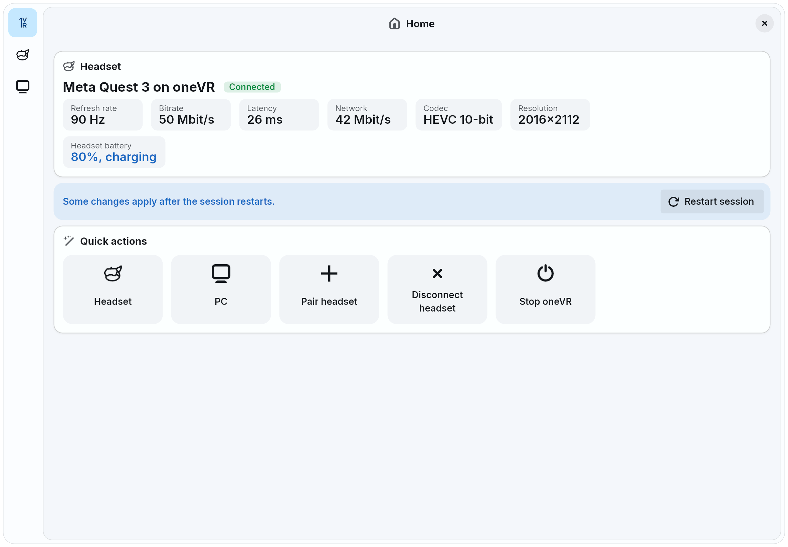

# oneVR



oneVR lets you play PC VR games on a standalone headset, like a Meta Quest, from a Linux PC. The PC runs the game and streams it to the headset over Wi-Fi or a USB cable, and the headset sends back where you look and what your hands do.

You don't need SteamVR. Games made for SteamVR run through oneVR directly, and your Steam VR games show up in a library you can launch from inside the headset. In VR you can also see your desktop, open extra monitors that exist only in VR, and change every setting without taking the headset off.

It is one app on the PC and one app on the headset. Under the hood it combines three open source projects: [WiVRn](https://github.com/WiVRn/WiVRn) for the streaming, [xrizer](https://github.com/360900/xrizer-edge) so SteamVR games run without SteamVR, and [wayvr](https://github.com/wayvr-org/wayvr) for the desktop and menus in VR.

# What you need

- A Linux PC with a graphics card that can run VR games
- A Meta Quest (2, 3, 3S or Pro) or a Steam Frame
- The PC and the headset on the same network. A PC connected by cable and the headset on 5 GHz Wi-Fi gives the smoothest stream. A USB cable works too.

# Install

oneVR is installed twice: once on the PC and once on the headset. Start by downloading this repository:

```sh
git clone https://github.com/360900/oneVR.git
cd oneVR
```

## On the PC

**Arch Linux and distributions based on it.** In this folder, run:

```sh
cd packaging/arch && makepkg -si
```

This builds oneVR and installs it like any other package. It works alongside WiVRn or wayvr if you have them installed.

**Other distributions.** First install the tools and libraries oneVR is built from. Their names differ between distributions; the `depends` and `makedepends` lists in [packaging/arch/PKGBUILD](packaging/arch/PKGBUILD) show what is needed. Then run:

```sh
./install.sh
```

This builds oneVR and installs it for your user only, without needing root. oneVR then appears in your app menu. If a Quest is plugged in, it also installs the headset app (see below).

**Ready-made build.** The [latest release](https://github.com/360900/oneVR/releases/latest) has `onevr-x86_64.tar.gz`, built on Arch Linux. It skips the build step but may not run on every distribution. To install it:

```sh
sudo tar -xzf onevr-x86_64.tar.gz -C /
ln -s /opt/onevr/bin/onevr ~/.local/bin/onevr
ln -s /opt/onevr/share/applications/io.github.onevr*.desktop ~/.local/share/applications/
```

## On the headset

**Meta Quest.** The headset app isn't in the Meta store yet, so it is installed from the PC over a USB cable:

1. Turn on developer mode for your Quest in the Meta Horizon app on your phone.
2. Install `adb` on the PC (often in a package called `android-tools`).
3. Plug the Quest into the PC, put it on and allow USB debugging when it asks.
4. Run `./sideload.sh` in this folder. It downloads the latest headset app and installs it on every Quest that is plugged in.

The app then appears on the Quest under Apps, in the Unknown Sources section.

**Steam Frame.** Download `onevr-frame` from the [latest build](https://github.com/360900/oneVR/actions/workflows/ci.yml?query=branch%3Amain) (you need to be logged in to GitHub). Copy it to the headset and extract it, add `onevr-frame/bin/onevr` to Steam as a non-Steam game, and start it from your Library.

# First connection

1. On the PC, open oneVR from your app menu. Its window shows whether a headset is connected.
2. On the headset, open oneVR. It finds your PC on the network; select it.
3. The first time, the PC shows a PIN. Enter it on the headset. This pairs them, so next time they connect without the PIN.

The first time it starts, oneVR may ask to open your firewall and turn on Avahi, the service that lets devices on your network find each other. The headset needs both to find the PC.

If the headset doesn't find the PC, run `onevr doctor` in a terminal. It checks the network, graphics card, Steam, audio and the rest, says what is wrong, and `onevr doctor --fix` repairs what it can. The same checks are in the PC page of oneVR, under Diagnostics.

# Using oneVR

Once the headset is connected, oneVR's menu is in VR with you. It has these pages:

- **Home**: the connection, battery levels, the game that is playing, and quick switches like passthrough (seeing your room through the headset's cameras). This is also where you add virtual monitors: up to three extra screens that exist only in VR and that your desktop treats like real monitors.
- **Library**: your VR games. Steam games with VR support appear on their own; games that get VR from a mod, and other VR apps, can be added with Add apps. Select a game to start it.
- **Running**: the VR apps that are open, to bring one to the front or close it.
- **Headset**: picture quality, sound, microphone, hand, eye and body tracking, and forwarding a keyboard, mouse or gamepad that is connected to the headset. The Automatic quality preset suits most setups.
- **PC**: performance statistics, paired headsets, the video encoder, starting oneVR when you log in, and Diagnostics.

The same pages are in oneVR's window on the PC, so you can set things up before putting the headset on.

Closing the window doesn't stop oneVR. It keeps running in the system tray, ready for the headset. To stop it, use Stop oneVR in the tray, the window or the menu in VR.

**Starting games from Steam instead.** Games from the Library start ready for VR. If you start a VR game from Steam itself, it may need launch options: run `onevr steam` to see them, and paste them into the game's Properties in Steam. If it prints nothing, no launch options are needed.

Some games need a fix to work. [docs/compatibility.md](docs/compatibility.md) lists tested games.

# Commands

Everything is in the window and the menu in VR, but oneVR can also be run from a terminal:

| Command | What it does |
|---|---|
| `onevr` | Opens oneVR, the same as from the app menu |
| `onevr --tray` | Starts oneVR in the tray without opening the window |
| `onevr start`, `onevr stop` | Starts or stops oneVR in the background, without the window |
| `onevr status` | Says whether oneVR is running, which headset is connected and whether pairing is on |
| `onevr logs` | Shows oneVR's log, useful when reporting a problem |
| `onevr pair` | Pairs another headset. This ends the current session. |
| `onevr headsets` | Lists the paired headsets; `onevr rename` and `onevr unpair` rename or forget one |
| `onevr usb` | Connects to a headset plugged in by USB instead of Wi-Fi |
| `onevr install FILE.apk` | Installs an app on a headset plugged in by USB |
| `onevr steam` | Shows the launch options for starting VR games from Steam |
| `onevr doctor` | Checks the PC for problems; `--fix` repairs what it can |

oneVR keeps its settings in `~/.config/onevr/`. It shares pairing with WiVRn, so a headset paired with one is paired with both.

# Updating and uninstalling

**Updating.** Get the latest version of this folder (for example with `git pull`) and install again the same way: `makepkg -si` on Arch, `./install.sh` elsewhere. If oneVR is running, `install.sh` asks to close it and opens it again afterwards. If the update fails, the version you had keeps working. Update the headset app too with `./sideload.sh`; the PC and headset need matching versions.

**Uninstalling.** On Arch, remove the `onevr-git` package. Elsewhere, run `./uninstall.sh`. Both keep your settings and pairing, in case you install oneVR again.

# Development

To build and try changes without installing:

```sh
cargo xtask run
```

This builds into `target/stage` and starts oneVR from there. Build options such as `--i686` go before `--`, and options for `onevr` after it.

Other builds:

- `cargo xtask apk --debug`: the headset app, as an APK to sideload. Needs the Android SDK and NDK.
- `cargo xtask apk --store`: the Meta Horizon Store's version of the headset app, a separate package, signed with the keystore in `ONEVR_STORE_KEYSTORE`. `cargo xtask store-check` says whether a PC release has to wait for a store update.
- `cargo xtask frame`: the Steam Frame app. Needs an arm64 machine.

oneVR's changes to WiVRn, xrizer and wayvr are listed in [CHANGES.md](CHANGES.md), which also explains how to merge new upstream versions. Run `cargo xtask rebrand` after merging.

# License

GPL-3.0. Each component keeps its own license files.
