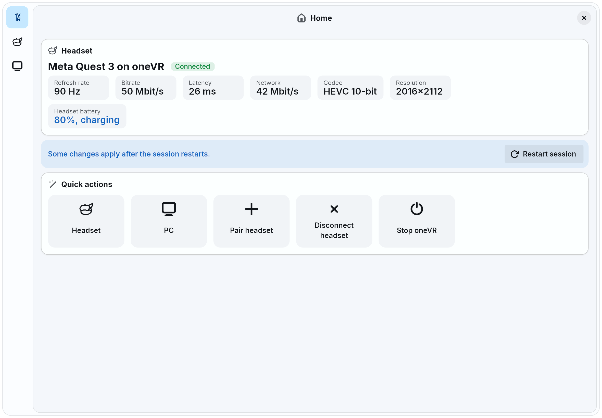

# oneVR



Stream VR from a Linux PC to a standalone headset, run SteamVR games without SteamVR and use your desktop in VR, with one app and one headset APK.

oneVR combines:

- [WiVRn](https://github.com/WiVRn/WiVRn) (`wivrn/`): streaming server and headset client
- [xrizer-edge](https://github.com/360900/xrizer-edge) (`xrizer/`): OpenVR on top of OpenXR
- [wayvr](https://github.com/wayvr-org/wayvr) (`wayvr/`): desktop overlay

# Install

Arch Linux:

```sh
cd packaging/arch && makepkg -si
```

This installs to `/opt/onevr` and adds `onevr` to the app menu. It doesn't conflict with system WiVRn or wayvr packages.

Other distributions: install the build dependencies of WiVRn, xrizer and wayvr, then:

```sh
./install.sh
```

This builds oneVR, installs it to `~/.local/opt/onevr`, links `onevr` into `~/.local/bin` and adds oneVR to the app menu. Run it again to update; it stops a running oneVR first. If a Quest is connected over adb, it also installs the latest headset APK from CI on it, which needs `gh` logged in. `./uninstall.sh` removes it and keeps the settings and pairing.

On Plasma before 6.8, the hidden `io.github.onevr.wayvr.desktop` entry lets oneVR capture screens without a dialog and add virtual monitors.

The headset APK is the `onevr-apk-release` artifact of [CI](https://github.com/360900/oneVR/actions/workflows/ci.yml).

The Steam Frame takes the `onevr-frame` artifact instead: extract it on the headset, add `onevr-frame/bin/onevr` to Steam as a non-Steam game and start it from the Library. It streams H.264 and 8-bit H.265.

# Usage

Run `onevr` (or oneVR from the app menu) to start the server in the background and open oneVR's window, with pairing and the headset and server settings; closing it leaves the server and a tray icon, and stopping the server from anywhere closes both. Open oneVR on the headset and pick this PC; the first time, enter the PIN the PC shows. Once connected, the settings are in the dashboard in VR too. OpenVR games use the bundled xrizer.

oneVR keeps its server settings in `~/.config/onevr/wivrn-server.json`. Pairing is shared with WiVRn.

- `onevr start`: the server without the window; `onevr stop`, `onevr status`, `onevr logs`
- `onevr pair`: pair another headset
- `onevr headsets`, `onevr rename`, `onevr unpair`: manage paired headsets
- `onevr usb`: connect the headset plugged in by USB; `onevr install APK` installs the app
- `onevr steam`: launch options for Steam VR games, if they need any
- `onevr doctor`: check the PC for VR (network, GPU, runtimes, Steam, input, audio); `--fix` repairs what it can, the first start offers to open the firewall and start Avahi
- `onevr server`: the server in the foreground

# Development

```sh
cargo xtask run
```

This builds into `target/stage`, installs there and starts its `onevr`. Build options such as `--i686` go first, arguments after `--` go to `onevr`.

`cargo xtask apk --debug` builds an installable headset APK and needs the Android SDK and NDK. `cargo xtask apk --store` builds the Meta Horizon Store's app, a separate package, and signs it with the keystore in `ONEVR_STORE_KEYSTORE`; `cargo xtask store-check` tells whether a PC release has to wait for a store update. `cargo xtask frame` builds the Steam Frame's app and needs an arm64 host. Upstream changes are merged as described in [CHANGES.md](CHANGES.md), followed by `cargo xtask rebrand`.

# License

GPL-3.0. Each component keeps its own license files.
